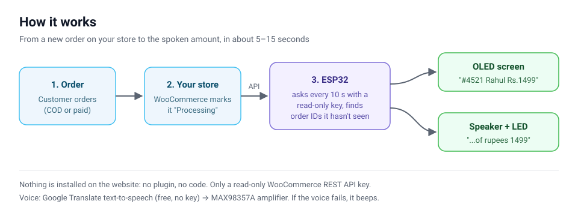
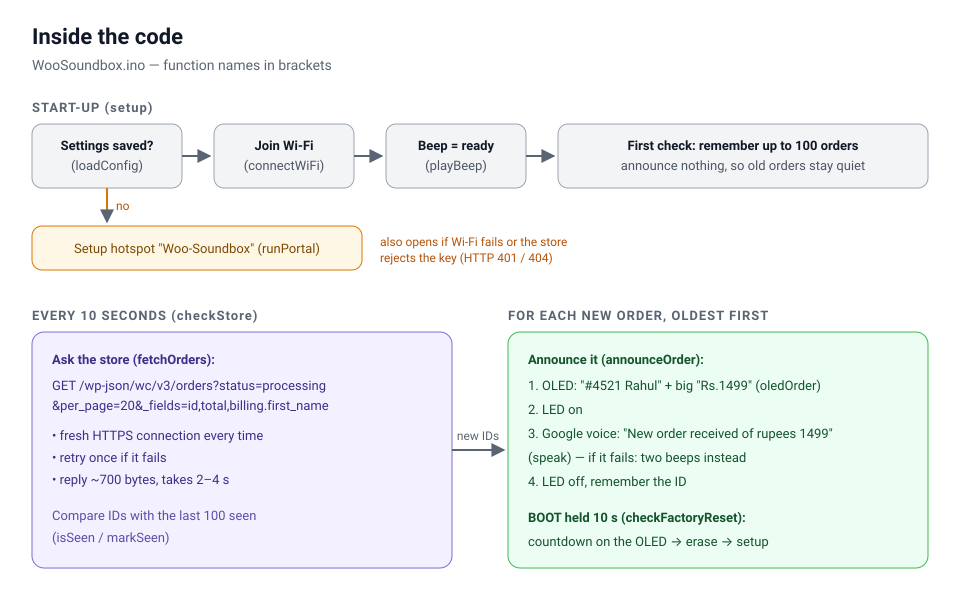

# WooCommerce Soundbox: Web Flasher

A **techiesms** project · [YouTube](https://www.youtube.com/@techiesms) · [techiesms.com](https://techiesms.com)

An ESP32 that **speaks every new order from your WooCommerce store**, like the UPI soundbox in shops: *"New order received of rupees 1499"*, with the order shown on a small OLED.

**No plugin and no code on the website.** It only needs a read-only WooCommerce REST API key.

**Flasher page:** https://shubhjaiswal408.github.io/woo-soundbox-flasher/
**Source code:** [`source/WooSoundbox/`](source/WooSoundbox)

> Hobby project. Not affiliated with or endorsed by WooCommerce or Automattic.

---

## How it works





---

## 1. What's in this repository

```
woo-soundbox-flasher/
├── index.html                       ← the flasher web page
├── manifest.json                    ← tells ESP Web Tools which files go where
├── .nojekyll
├── README.md                        ← this guide
├── assets/                          ← diagrams + logo
├── source/
│   └── WooSoundbox/
│       ├── WooSoundbox.ino          ← Arduino source
│       └── secrets.h                ← optional form defaults (empty here)
└── firmware/
    ├── WooSoundbox.bootloader.bin   → 0x1000
    ├── WooSoundbox.partitions.bin   → 0x8000
    ├── boot_app0.bin                → 0xe000
    ├── WooSoundbox.bin              → 0x10000
    └── WooSoundbox.merged.bin       → 0x0 (manual flashing only)
```

The published firmware contains **no Wi-Fi password, store URL or API key**. Every box is set up from its own Wi-Fi setup page.

### Flash offsets (classic ESP32)

| File | Offset |
|---|---|
| `WooSoundbox.bootloader.bin` | `"0x1000"` |
| `WooSoundbox.partitions.bin` | `"0x8000"` |
| `boot_app0.bin` | `"0xe000"` |
| `WooSoundbox.bin` | `"0x10000"` |

> Classic ESP32 bootloader is at **`0x1000`**, not `0x0` (that's only for ESP32-C3 / C6 / S3).

---

## 2. Hardware

| Part | Connect to |
|---|---|
| ESP32 Dev Module (DOIT DevKit V1 etc.) | |
| 0.91" SSD1306 OLED 128×32 (I2C) | VCC→3V3, GND→GND, SDA→GPIO 21, SCL→GPIO 22 |
| MAX98357A I2S amplifier | VIN→5V, GND→GND, DIN→GPIO 27, BCLK→GPIO 26, LRC→GPIO 25 |
| Speaker 4–8 Ω, 2–3 W | to the amplifier's + and − **only** (never to GND) |
| LED | on-board LED (GPIO 2), lights while speaking |

- Put a **470–1000 µF capacitor** across the amp's VIN and GND, so loud sounds don't reset the ESP32.
- Amp GAIN pin: unconnected = 9 dB, to GND = 12 dB (louder).

---

## 3. Make a read-only API key

1. WordPress admin → **WooCommerce → Settings → Advanced → REST API**.
2. **Add key**. Description: `Soundbox`. User: an admin. **Permissions: Read**.
3. Copy the **Consumer key** (`ck_…`) and **Consumer secret** (`cs_…`). The secret is shown only once.

> Even a read-only key can read customer names and addresses, so keep it private.

---

## 4. Flash and set up

1. Open the [flasher page](https://shubhjaiswal408.github.io/woo-soundbox-flasher/) in **Chrome or Edge** on a computer.
2. Plug the ESP32 in (data cable) → **Flash Firmware** → pick the port → **Install** (keep *Erase device* ticked).
3. After *Installation complete*, the OLED shows **SETUP MODE**.
4. On a phone, join Wi-Fi **`Woo-Soundbox`**, password **`soundbox`**. The setup page opens (or go to `192.168.4.1`).
5. Enter your 2.4 GHz Wi-Fi, the store URL (`https://yourstore.com/`), the key and the secret → **Save**.
6. It restarts, beeps, and starts watching for orders.

On the first check it **remembers the orders that already exist** and doesn't announce them. Only orders after that are spoken.

**To change settings later:** hold the board's **BOOT** button for **10 seconds** while it runs. A countdown appears on the OLED, then it erases the settings and opens setup again.

---

## 5. What it announces

- Orders in **Processing** status: COD orders and confirmed online payments. Pending payments and abandoned carts are never announced.
- Each check fetches the latest **20** processing orders. The box remembers the last **100** IDs it has seen and announces new ones **oldest first**.
- Delay: it checks every **10 s**, plus 2–4 s per request, so expect **about 5–15 s** from order to voice.

### Known limitations
- **Not instant**, because it checks on a timer. Faster checking can overload shared hosting, so keep 10 s or more (15–30 s on cheap hosting).
- **The Google TTS endpoint is unofficial:** free, but it could be limited or changed. If it fails, the box **beeps twice** instead.
- **`setInsecure()`** skips the HTTPS certificate check. Fine for learning; a product should check certificates.
- **Orders placed while the box is off** aren't announced after it restarts.

---

## 6. Source code & customising

### Build it yourself

| Setting | Value |
|---|---|
| Arduino core | **esp32 by Espressif 3.1.2** |
| Board | **ESP32 Dev Module** |
| Partition Scheme | **Huge APP (3MB No OTA/1MB SPIFFS)** |

| Library | Version |
|---|---|
| ArduinoJson (by Benoit Blanchon) | 7.4.3 |
| ESP32-audioI2S (by schreibfaul1) | **3.0.13**. Newer versions don't build on core 3.1.2 |
| Adafruit SSD1306 | 2.5.17 |
| Adafruit GFX Library | 1.12.6 |

`WiFi`, `WiFiClientSecure`, `HTTPClient`, `WebServer`, `DNSServer`, `Preferences` and `ESP_I2S` come with the ESP32 core.

**`secrets.h`** only pre-fills the setup form. Leave it empty for boards you give to others. Fill it in for your own boards, so setup is just *Save*. Never publish a `secrets.h` with real keys.

### Common changes

| You want to… | Change this in `WooSoundbox.ino` |
|---|---|
| Speak in Hindi | Uncomment `//#define ANNOUNCE_HINDI` |
| Change the sentence | `buildSpeech()` |
| Check more or less often | `POLL_INTERVAL` (ms, default 10000) |
| Announce other statuses | `status=processing` in `fetchOnce()` (e.g. `processing,on-hold`) |
| Change the OLED layout | `oledOrder()` and `oledHome()` |
| Louder / softer | `AUDIO_VOLUME` (0–21), `BEEP_AMPLITUDE` |
| Different LED pin | `LED_PIN` |

---

## 7. Troubleshooting

| Problem | Fix |
|---|---|
| No port in the list | Try another USB cable (many are charge-only); install the [CP210x](https://www.silabs.com/developers/usb-to-uart-bridge-vcp-drivers) or [CH340](https://www.wch-ic.com/downloads/CH341SER_EXE.html) driver |
| "Failed to connect" | Hold BOOT, press and release EN, release BOOT, then try again. Close the Serial Monitor |
| "Failed to download manifest" | Open the https Pages URL, not the local file; hard-refresh with `Ctrl + F5` |
| Setup says "store rejected the API key" | Wrong key/secret, or the key isn't **Read**. Make a new key |
| Setup says "Store not found (HTTP 404)" | Check the URL (`https://yourstore.com/`). WordPress permalinks must not be "Plain" |
| HTTP -11 timeouts, website slow | The host is rate-limiting; raise `POLL_INTERVAL` to 15–30 s |
| OLED blank | Check SDA 21 / SCL 22 / VCC 3V3. The Serial Monitor prints an I2C scan at start-up |
| Board keeps restarting | Power: better cable/charger, check loose wires, add the 470–1000 µF capacitor |

### Manual flashing (no browser)

```bash
esptool.py --chip esp32 --port COM5 --baud 921600 write_flash 0x0 firmware/WooSoundbox.merged.bin
```

### Browser support
Chrome and Edge 89+ on a computer. Firefox, Safari and phone browsers can't flash (no Web Serial).
